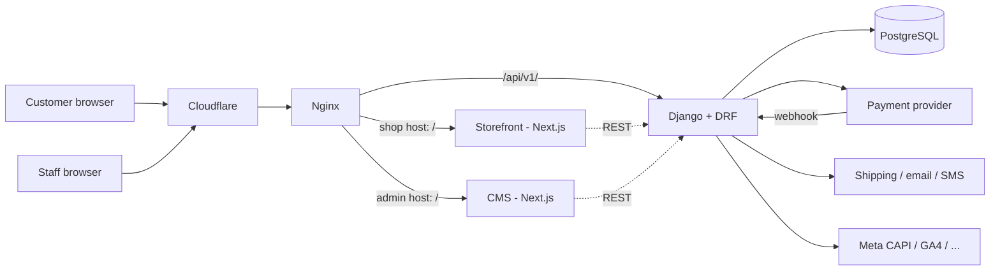

# Architecture

## Overview

Execution domains: **Frontend (Storefront)**, **CMS**, **Backend**, **Integration**, **DevOps**, plus the shared spec. Deployables: storefront, CMS, backend + one database. The backend is a **modular monolith**. No microservices, broker, or cache layer until a measured need exists (each needs an ADR).

**Django Admin is not used.** The operational CMS is a custom Next.js app ([cms-architecture](cms-architecture.md)); `django.contrib.admin` is not installed.

> Items marked *(pending ADR)* depend on Proposed ADRs 0003, 0004, 0007–0011.

## Backend Structure
```text
backend/
├── config/               # settings (base/dev/staging/prod), urls, wsgi/asgi
└── apps/
    ├── users/            # customers, staff, roles/permissions, addresses
    ├── products/
    ├── categories/
    ├── cart/
    ├── orders/
    ├── payments/
    ├── reviews/
    ├── common/           # base models, pagination, exceptions, permission helpers
    # Added when their first feature task needs them (pending ADR-0011):
    ├── audit/            # append-only admin audit log
    ├── content/          # structured storefront content
    ├── promotions/       # coupons/discount rules (only when required)
    ├── integrations/     # integration settings, provider adapters, tracking dispatch
    └── analytics/        # read-only dashboard selectors
```
Each app: `models.py`, `serializers.py`, `views.py`, `urls.py`, `permissions.py`, `services.py` (when needed), `selectors.py` (when needed), `tests/`, `migrations/`. No other apps without approval.

URLs are split by audience: each app contributes routes to `storefront`, `customer`, and/or `admin` URL modules mounted under `/api/v1/<namespace>/` ([ADR-0008](decisions/ADR-0008-api-namespaces.md)).

Dependency direction: `orders → cart, products, users, payments, promotions`; `reviews → products, orders, users`; `integrations`/`audit` are called *by* services (e.g. orders/payments emit tracking events and audit entries) and never import feature apps' views; everything may use `common`. Cross-app calls go through `services`/`selectors`, not views.

## Where Logic Lives
| Layer | Responsible for | Must NOT |
|---|---|---|
| **Models** | Fields, constraints, indexes, single-row invariants | Call other apps, perform I/O, orchestrate workflows |
| **Serializers** | Input shape/field validation, output representation. **Separate serializers per audience** (storefront / customer / admin) | Contain workflows or multi-model writes; reuse admin serializers publicly |
| **Views/ViewSets** | HTTP: auth, permission classes, parse → service/selector → respond | Business rules, complex queries |
| **Services** | Write operations and workflows (place order, change stock, change order status, set discount). `transaction.atomic`; write audit entries for admin actions | Know about HTTP/request objects |
| **Selectors** | Complex reads (optional) incl. dashboard aggregates | Mutate data |
| **Permissions** | Who may access (`IsAuthenticated`, `HasPermission("orders.update")`, ownership) | Business workflows |

### Complex Business Operations
`view → serializer (validate shape) → service (rules + transaction + audit) → serializer (response)`. Services take explicit args (including the acting user), return model instances, raise domain exceptions mapped to the standard error format; side effects (email, tracking dispatch) run `on_commit`. Use `select_for_update` for stock/order/payment state. No service classes/DI/repositories — plain functions.

**The same service is used by storefront and CMS paths** (e.g. one `change_order_status` regardless of caller) so business rules are never duplicated in the CMS.

## Applications (Next.js)
### Storefront (`frontend`)
Customer-facing: home, products, product detail, cart, checkout, account. Structure:
```text
frontend/src/
├── app/  components/{ui,features/<domain>}/  lib/{api,tracking}/  hooks/  types/  styles/
```
Server Components by default. Content (hero, banners, featured) comes from `/storefront/content` APIs; layout/components stay in code. Single tracking module `lib/tracking`.

### CMS (`cms`) — pending ADR-0007
Operator-facing: dashboard, products, categories, orders, customers, promotions, content, analytics, integrations, settings. Own repo, own deployment, own auth audience. Same layout conventions as storefront, plus `components/features/<module>/`, a permission-aware navigation, and a typed admin API client. See [cms-architecture](cms-architecture.md).

## Cross-Cutting
- **Config:** 12-factor env vars; [environments](../devops/environments.md).
- **Auth:** [ADR-0003](decisions/ADR-0003-auth-token-strategy.md) (customers), [ADR-0009](decisions/ADR-0009-cms-auth-rbac-audit.md) (CMS RBAC).
- **Audit:** admin writes are audited in the backend.
- **Tracking/integrations:** centralized in backend `integrations` + storefront `lib/tracking` ([ADR-0010](decisions/ADR-0010-integrations-secrets-tracking.md)).
- **Logging:** structured, no PII/secrets/tokens. **Time:** UTC ISO-8601.
- **Media:** Django storage abstraction; backend validates uploads; storage backend (local volume vs object storage) decided in DevOps task.
- **Documentation:** API changes → contract; architecture changes → ADR.
