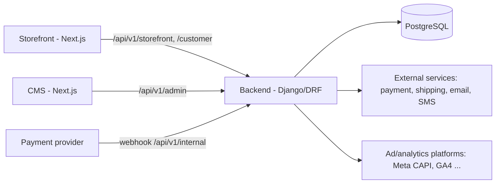

# CMS Architecture

The Lumera **CMS** is a custom-built Next.js application: the operational control center for catalog, orders, customers, content, promotions, payments visibility, integrations, and settings. **Django Admin is not used and not installed** (`django.contrib.admin` is excluded from `INSTALLED_APPS`).

Status of the structural choices below: see [ADR-0007](decisions/ADR-0007-cms-application.md) (Proposed), [ADR-0008](decisions/ADR-0008-api-namespaces.md) (Proposed), [ADR-0009](decisions/ADR-0009-cms-auth-rbac-audit.md) (Proposed), [ADR-0010](decisions/ADR-0010-integrations-secrets-tracking.md) (Proposed), [ADR-0011](decisions/ADR-0011-backend-app-additions.md) (Proposed).

## 1. Position in the System

Storefront, CMS, Backend API, Database, External services, Tracking, and Infrastructure are separate responsibilities (see [system-boundaries](system-boundaries.md)).

## 2. CMS Responsibility
**Owns:** admin UI/UX, forms, tables, filters, dashboards, navigation, permission-aware UI (hide/disable what the user cannot do), file upload interaction, previews.
**Does NOT own (hard rules):**
- no direct DB access; no direct calls to payment/shipping/marketing providers;
- no authoritative pricing/total/stock/permission logic (it displays and submits data; the backend validates and recalculates);
- no secrets in the browser bundle or `NEXT_PUBLIC_*` variables;
- route protection in the CMS is **UX only**; the backend authorizes every request.

## 3. CMS ↔ Backend Communication
- Only REST under `/api/v1/admin/` (plus `/api/v1/admin/auth/`) as defined in `contracts/api-contract.yaml`. Contract changes land before implementation (CMS typed client generated/checked against the contract).
- Same JSON conventions, error format, pagination, filtering and ordering as [api-architecture](api-architecture.md).
- Admin list endpoints support `search`, `ordering`, filters, `page_size` ≤ 100; exports (CSV) are explicit endpoints with their own permission, not client-side scraping.
- Writes send ids and editable data only; computed fields (`effective_price`, totals, `status` transitions) are read-only or performed via action endpoints (`POST /admin/orders/{id}/status/`).
- Optimistic concurrency for editable resources: `updated_at`/ETag check (`If-Match`) returning `409 conflict` on stale edits (to be detailed in first CMS task).
- Image upload: `multipart/form-data` to the backend, which validates type/size and stores; the CMS never writes to storage directly.

## 4. CMS Authentication
- Dedicated endpoints `/api/v1/admin/auth/{login,refresh,logout}/`; only accounts with CMS access (`is_staff=true`, active) succeed. Customers cannot obtain CMS tokens.
- CMS tokens carry audience `cms`; storefront/customer tokens are rejected by `/admin/` and vice-versa.
- Shorter lifetimes than storefront (proposed: access 10 min, refresh 8 h absolute, no "remember me").
- Same mechanism as [ADR-0003](decisions/ADR-0003-auth-token-strategy.md) (access token in memory, rotating HttpOnly refresh cookie scoped to `/api/v1/admin/auth/`), served same-origin on the CMS host.
- Staff MFA (TOTP) recommended; decision deferred to the auth task (open question). Login throttling and lockout stricter than storefront.
- Optionally the CMS host sits behind Cloudflare Access / IP allow-list (DevOps decision).

## 5. CMS Authorization
Granular, permission-based RBAC enforced by the backend ([ADR-0009](decisions/ADR-0009-cms-auth-rbac-audit.md)):
- **Permissions** are code-defined `resource.action` strings. **Roles** are named sets of permissions stored as data (managed by `staff.manage`), so no code change is needed to add a role.
- Initial seed: only `super_admin` (all permissions). Other roles (Admin, Manager, Operator, Content Manager, Order Manager…) are **created from real business needs**, not pre-built; recommended presets are listed in [security.md](../security/security.md).
- Every admin view declares its required permission(s); default is deny. Object-level scoping is added only where required.
- `GET /admin/auth/me/` returns the user's permission list so the CMS can render the UI; this is advisory — the backend re-checks.

Initial permission catalog (to be refined per feature task):
| Area | Permissions |
|---|---|
| Catalog | `products.read`, `products.write`, `products.delete`, `categories.read`, `categories.write`, `categories.delete`, `inventory.update` |
| Orders | `orders.read`, `orders.update`, `orders.notes`, `orders.cancel`, `orders.export` |
| Customers | `customers.read`, `customers.update_status` |
| Payments | `payments.read` (status/reference), `payments.read_sensitive` (provider detail), `payments.refund` |
| Promotions | `promotions.read`, `promotions.write` |
| Content | `content.read`, `content.write`, `content.publish` |
| Dashboard | `dashboard.read` |
| Reviews | `reviews.read`, `reviews.moderate` |
| Settings | `settings.read`, `settings.write` |
| Integrations | `integrations.read`, `integrations.manage` |
| Staff & audit | `staff.manage`, `audit.read` |

## 6. CMS Modules
Each module is delivered **together with its backend feature** (see [roadmap](../tasks/roadmap.md)); none exist yet. Modules map to the CMS navigation:

| Module | Capabilities (eventual) | Backend area |
|---|---|---|
| Dashboard | Totals, pending orders, revenue, product count, low-stock, recent orders, top products, trends, customer metrics, marketing metrics (when integrated) | `analytics` selectors |
| Products | Create/edit/archive; name, description, images, price, discount price, stock, SKU, status, visibility, categories, metadata, featured, ordering; attributes only if a requirement appears | `products` |
| Categories | Create/edit/archive; image, description, slug, ordering, visibility; **flat unless requirements justify hierarchy** | `categories` |
| Orders | List/search/filter/detail; lines, quantities, prices, discounts, totals, shipping info, status update, payment status, internal notes | `orders`, `payments` |
| Customers | List/search/profile/order history/account status/addresses (policy-limited) | `users` |
| Promotions | Product discount price, coupons, discount rules/campaigns (only when required) | `promotions`, `products` |
| Content | Homepage sections, hero/banners, promo banners, announcement bar, featured products/categories, static pages, SEO metadata, navigation content | `content` |
| Reviews | Moderation queue | `reviews` |
| Analytics | Sales trends, product demand, tracking/marketing metrics | `analytics` |
| Integrations | Payment/shipping/SMS/email/analytics/marketing configuration; tracking config; provider status | `integrations` |
| Settings | Store settings, staff & roles, audit log viewer | `users`, `audit`, `integrations` |

### Product/cart operational visibility & privacy
- CMS shows product availability, stock, order quantities per product, and **aggregate** demand indicators (e.g. "in N active carts", add-to-cart counts).
- **Individual customers' carts are never exposed in the CMS** (no endpoint exists). Revisit only with an explicit requirement + privacy review.

### Customer data policy
- `customers.read` exposes: name, email, phone, status, order history summary. Addresses are visible only with the order context (`orders.read`) or a customer's profile with `customers.read`; password hashes, tokens, and payment instrument details are never exposed.
- Sensitive fields can be masked by default with an explicit "reveal" action that is audit-logged (decide per task).

### Content management scope
Structured content model, **not a drag-and-drop page builder**: typed blocks the storefront already knows how to render (e.g. `hero`, `promo_banner`, `featured_products`, `featured_categories`, `announcement_bar`, `rich_text_page`) with fields, ordering, scheduling (`starts_at/ends_at`), `draft/published` status, and SEO metadata. New block types require frontend work + contract update. Rich text is stored as sanitized, constrained markup (no raw script/HTML injection).

### Pricing and promotions
CMS edits price data (`price`, `discount_price`, coupons, campaigns). The backend validates (`discount_price < price`, dates, usage limits) and **recalculates everything** at cart/checkout/order time. CMS previews are display-only.

### Order lifecycle & payment status
Operators move orders through status via backend action endpoints that enforce allowed transitions; payment status is shown separately and changes only via verified payment processing or an explicit permissioned action (`payments.refund`). Lifecycle definition: [business-rules](../business-rules.md) (BR-12, proposed, needs business confirmation).

## 7. CMS API Boundaries
All CMS traffic is under `/api/v1/admin/`. Public/customer namespaces are never extended with admin behaviors, and admin endpoints are never reachable without authentication + permission. See [api-architecture](api-architecture.md) and [ADR-0008](decisions/ADR-0008-api-namespaces.md).

## 8. Secret Handling
- Secrets (API secrets, access tokens, private keys, webhook secrets, payment secrets, OAuth client secrets, DB credentials) are **never** sent to browsers, including the CMS. CMS secret fields are **write-only**: API returns `{ "is_set": true, "updated_at": … }`, never the value.
- Public configuration (Pixel ID, public client ID, measurement IDs) is stored flagged `public` and may be returned by the storefront config endpoint (whitelist).
- Secrets stored encrypted at rest (application-level key from the environment); bootstrap secrets (DB credentials, Django secret key, encryption key) exist **only** in environment/secret store, never in the DB or CMS.
- Changes require `integrations.manage`, are audited (without values), and are never logged. Details: [ADR-0010](decisions/ADR-0010-integrations-secrets-tracking.md), [security.md](../security/security.md).
- Payment flow: `CMS → Backend API → Payment Provider`. The browser never calls provider secret APIs.

## 9. Audit Requirements
Backend-side audit log (`audit` app, append-only) written by services — not by the CMS client. Recorded for admin write actions: actor, timestamp (UTC), action code, resource type/id, summary, before/after for allowed fields (secrets and personal data redacted), request id, IP. Minimum audited actions: price/discount change, stock change, product publish/archive, order status change, order note, refund/payment config, integration/tracking config, role/permission changes, staff login failures, reveal of masked data. Viewer requires `audit.read`; entries cannot be edited or deleted via the API. Retention TBD. Start minimal (one table + helper), no event-sourcing.

## 10. Deployment Considerations
- Separate application/container/pipeline from the storefront; independently deployable ([ADR-0007](decisions/ADR-0007-cms-application.md)).
- Dedicated host (e.g. `admin.<domain>`), Nginx routes `/` → CMS, `/api/v1/` → backend (same-origin on that host); optionally fronted by Cloudflare Access / IP allow-list.
- `noindex`/no sitemap, `X-Robots-Tag: noindex`; stricter CSP, `frame-ancestors 'none'`, no third-party scripts (no tracking pixels in the CMS).
- Own env vars (`NEXT_PUBLIC_API_BASE_URL`, no secrets); CORS/CSRF allow-lists include the CMS origin explicitly.
- Dev ports: storefront 3000, CMS 3001, backend 8000. CMS has staging and production like the other apps.
- A CMS release must remain compatible with the deployed backend/contract version (integration compatibility note).

## 11. UI Notes
Same brand tokens as the storefront (shared by documented copy, no shared package until justified), but denser, utility-first layout: data tables, filters, forms with inline validation, confirmation dialogs for destructive actions, loading/empty/error states, accessibility baseline (WCAG AA, keyboard-first).
