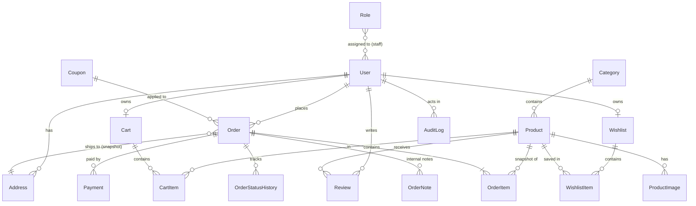

# Database Architecture

Database: **PostgreSQL** (single database). Entities below are a *high-level* model; field lists are indicative and are finalized in feature tasks.

## Conventions
- Tables: Django default `<app>_<model>`, `snake_case`, singular model names. Columns `snake_case`.
- FKs: `<model>_id`. Booleans: `is_`/`has_` prefix. Timestamps: `*_at`.
- **Primary keys:** `BIGINT` auto-increment `id` internally. Entities exposed in URLs where enumeration is sensitive (`User`, `Order`, `Payment`, `Address`) also have a unique `public_id` (UUID4); APIs use `public_id` for those, and `slug` for Category/Product. Admin APIs follow the same identifiers. ([ADR-0004](decisions/ADR-0004-primary-keys.md), Proposed)
- **Timestamps:** every table via `common.TimeStampedModel`: `created_at`, `updated_at` (UTC, `timestamptz`).
- **Money:** `NUMERIC(12,2)` + single configured currency.
- **Constraints:** enforce in DB where possible (`UNIQUE`, `CHECK`, `NOT NULL`, FK). Do not rely on application checks alone.
- **Indexes:** every FK (Django default), unique lookups (`slug`, `sku`, `email` lower-cased unique), and columns used in documented filters/sorts. Add further indexes only with evidence (query plan).
- **On delete:** `PROTECT` for anything referenced by orders; `CASCADE` only for pure children (CartItem→Cart, ProductImage→Product).
- **Soft deletion / archiving:** no generic soft-delete mixin. CMS "delete" on Product/Category means **archive** via explicit state (`status = archived`); hard delete is allowed only for never-referenced rows and requires `*.delete`. Other state: `status` on Order, `is_approved` on Review, `status` on content blocks. Users are deactivated (`is_active=false`), not deleted; account erasure/anonymization policy TBD.
- **Transactions:** required for order placement, stock changes, payment state changes, cart merge. Use `transaction.atomic`; `select_for_update` on stock/payment rows. `ATOMIC_REQUESTS` stays off; transactions are explicit in services.
- **Migrations:** committed, reviewed, generated by Django only; never edited after merge (add a new one). Backward-compatible (expand → migrate → contract) for deployments with running old code. Data migrations separate from schema migrations. CI checks `makemigrations --check`. Never hand-modify the production schema.

## ERD

## Entities (indicative)
| Entity | Key fields | Notes / constraints |
|---|---|---|
| **User** (`users`) | public_id, email, password, first_name, last_name, is_active, is_staff, last_login | Custom user model from the start (email login). Unique `lower(email)` |
| **Address** (`users`) | public_id, user, full_name, phone, line1, line2, city, region, postal_code, country | Belongs to user; at most one default per user (partial unique index) |
| **Category** (`categories`) | name, slug, description, image, status (`draft/active/archived`), sort_order, SEO title/description | Unique slug. **Flat** (no parent/child) until a requirement justifies hierarchy (then an ADR + migration) |
| **Product** (`products`) | name, slug, sku, description, price, discount_price (nullable), stock_quantity, category (PROTECT), status (`draft/active/archived`), is_visible, is_featured, sort_order, SEO title/description, metadata (small JSON, only if a requirement appears) | Unique slug & sku; `CHECK price >= 0`, `CHECK stock_quantity >= 0`, `CHECK discount_price IS NULL OR (discount_price >= 0 AND discount_price < price)`. Effective price computed by backend. Attributes/variants: not designed until required |
| **ProductImage** (`products`) | product, image, alt_text, sort_order, is_primary | One primary per product (partial unique index) |
| **Cart** (`cart`) | user (one-to-one, CASCADE) | Logged-in users only (guest cart: open question). Implicit singleton, no client-visible id ([ADR-0012](decisions/ADR-0012-cart-and-wishlist.md)) |
| **CartItem** (`cart`) | cart (CASCADE), product (CASCADE), quantity | Unique (cart, product); `CHECK quantity > 0`. **No price snapshot**: unit price/line total/subtotal are recomputed from Product on every read (BR-10); snapshot happens in OrderItem (BR-03) |
| **Wishlist** (`cart`) | user (one-to-one, CASCADE) | Implicit singleton per customer (ADR-0012) |
| **WishlistItem** (`cart`) | wishlist (CASCADE), product (CASCADE) | Unique (wishlist, product). No stock/price reservation |
| **Order** (`orders`) | public_id, user (PROTECT), status, subtotal, discount_total, coupon snapshot, shipping_total, total, currency, shipping address snapshot fields, placed_at | Totals computed server-side; address copied at placement. `status` = fulfillment lifecycle (BR-12); payment state lives on Payment |
| **OrderItem** (`orders`) | order, product (PROTECT), product_name, sku, unit_price (effective at purchase), list_price, quantity, line_total | Price/name snapshot; `CHECK quantity > 0` |
| **OrderStatusHistory** (`orders`) | order, from_status, to_status, changed_by (nullable user), changed_at, reason | Append-only; written by the status service (customer-visible timeline + ops history) |
| **OrderNote** (`orders`) | order, author, body | Internal only; never in customer APIs. Requires `orders.notes` |
| **Payment** (`payments`) | public_id, order, provider, method, provider_reference, amount, currency, status (`pending/paid/failed/refunded/partially_refunded`), raw_event refs | Unique (provider, provider_reference) for idempotency. Provider TBD |
| **Review** (`reviews`) | user, product, rating, title, body, is_approved | Unique (user, product); `CHECK rating BETWEEN 1 AND 5` |

## CMS-Driven Entities (each designed in the task that first needs it)
| Entity | App | Purpose / constraints |
|---|---|---|
| **Role**, role↔permission, staff↔role | `users` | Named permission sets (data); permission strings are code-defined ([ADR-0009](decisions/ADR-0009-cms-auth-rbac-audit.md)). Only `super_admin` seeded |
| **AuditLog** | `audit` | Append-only: actor, action, resource_type, resource_id, summary, before/after (redacted JSON), request_id, ip, created_at. Indexed by (resource_type, resource_id), actor, created_at. No update/delete paths |
| **ContentBlock / Page** | `content` | Typed blocks (`hero`, `promo_banner`, `featured_products`, `featured_categories`, `announcement_bar`, `rich_text_page`), fields JSON validated per type, sort_order, status (`draft/published`), `starts_at/ends_at`, SEO metadata. Not a page builder |
| **Coupon / DiscountRule / Campaign** | `promotions` | Only when required: code, type, value, validity window, usage limits/counters, eligibility. Backend recalculates at checkout |
| **IntegrationSetting** | `integrations` | provider, key, visibility (`public`/`secret`), `value_public` (plain, public only) or `secret_ciphertext` (encrypted), updated_by/at. Secrets never returned by any API ([ADR-0010](decisions/ADR-0010-integrations-secrets-tracking.md)) |
| **TrackingEventLog** (optional) | `integrations` | event_id (UUID, dedup), event_name, provider, status, attempts, timestamps; no raw PII/secrets; short retention |

Dashboard/analytics: computed by `analytics` selectors from existing tables (no dedicated tables initially; materialized/aggregate tables only with evidence).

## Not Yet Designed (intentionally)
Shipping rate tables, tax, product variants/attributes, inventory movements ledger, multi-warehouse, category hierarchy. Added only when requirements exist.
